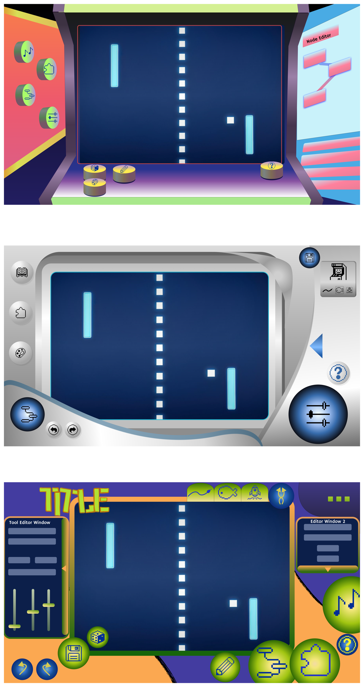

# Week 6

## Process

I was absent from last week's team meeting, so my teammates caught me up afterward. The main thing they discussed was updating the visuals so they are less distracting and closer to older Nintendo UIs. The idea is that a familiar, game-like look puts people in our demographic into a "game-playing" mindset without overwhelming them.

This week the team is preparing to present to Pippin. We have two things to show:

- **An interactable prototype** of the game editor, built from the earlier wireframe flow.
- **A visual prototype pitch** that applies the new visual direction on top of that UI.

### Visual pitches (FigJam: "Visual Pitches")

Julia & Olivia put together three visual designs based on our moodboards (original references, then an evolved set). Each leans in a slightly different direction, and all three show the main "Game Editing" page with a Pong game in the center:

1. **Arcade cabinet:** the game sits inside an arcade machine, with editing tools and a node view on the side panels and the mutators as coin-like objects on the floor.
2. **Handheld / console:** a metallic, rounded device frame with round buttons and a big sliders button, closest to a Wii/DS-era hardware feel.
3. **Playful, colourful editor:** bright purple, orange and green, with tool editor windows on both sides, slider controls and chunky round icon buttons.

Notes left on the board:

- Julia's goal: recreate the feeling of playing a game while creating one. References are Wii, DS and 2000s Nintendo. It should be accessible, with a lot of personality, and familiar to the target audience.
- Olivia's direction: blend the 2nd and 3rd designs, and mix them with the fun and readability of the Wii era.

[Add: what I personally worked on or reviewed this week.]

## Reflection

Coming back after missing a meeting, the main thing I had to do was understand why the visual direction changed. The reasoning makes sense to me: the editor should feel like play before it feels like software, which fits Pippin's brief of no technical knowledge required. With the new visual pitches, I feel that we have better direction with the final deliverable. I'm excited to soon get feedback and execute on a working prototype. 

Questions for Pippin:

- Does the Nintendo/Wii-era look read as familiar to the audience he has in mind?
- Does the interactable prototype feel like "no technical knowledge" in practice, or do the sliders and nodes still feel technical?

## Next Step

Present the interactable prototype and visual pitch to Pippin, then take his feedback into the next round of design.

[← Back to journal index](https://github.com/haniflearnscoding/CART470_ProcessJournal/blob/main/README.md)
