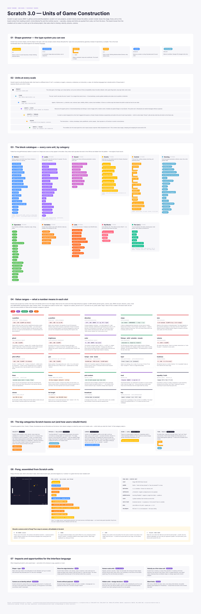

# Week 6

## Process
This week the team split up research into "units": the building blocks of game design (what a designer works with) and of game construction (what an engine gives a builder). The goal is to find the pieces our game editor's interface language should expose.

I chose to do research one Scratch as it might have insights on node based systems that feels accessible - something we will try to bring forward in the interface of our education game. 

## Scratch: Units of Game Construction (Figma: "Scratch Units")
[Figma board](https://www.figma.com/design/B19U0dZ1wAX4E3ICKY4MbG/Scratch-Units?node-id=0-1)

The board ears Scratch 3.0 down from its smallest unit up to the whole project. 

1. **Shape grammar:** the six block shapes, where the shape works as the type system.
2. **Units at every scale:** project, stage, targets, assets and state, scripts, blocks, inputs and fields.
3. **Block catalogue:** every core category, including opcodes hidden from the palette.
4. **Value ranges:** what a number means in each slot, sorted into clamp, wrap, unbounded, enum and limit.
5. **Missing units:** velocity, physics and collision, camera, scene or level, and time/delta, and how users rebuild them.
6. **Pong case study:** Pong assembled from Scratch units, plus four ways a camera could exist in it.
7. **Reflections:** which of Scratch's choices to copy, invert or question for our interface language.

## Reflection

When reflecting about the shapes of the blocks of code, the shape = type is a concept that can be helpful in our interface. In scratch, the value type is visible in the sihouette of a slot - booleans can't go in a number slot. This makes for no error messages. This is an approach that can help with future roadblocks in our node based interface, where the user will not be able to connect any node together. Fun face the MIT Media Lab have worked with the Lego Comapany - interesting collab to explore and research more if we want to learn about how kids play with Lego blocks and what findings they implement for Scratch blocks. (https://cacm.acm.org/research/scratch-programming-for-all/)

For velocity in scratch you learn to use smaller pieces to apply velocity instead of it being a velocity unit. I wonder if to some degree this is intentional because not everyone grasps the concept of velocity, and so in this case it might be a learning opportunity for the user. In lower level programming you learn to apply velocity, but you also learn to apply movement. There are different levels of abstraction in scratch: 

Position: set x to, where you place things directly.
Displacement: change x by or move steps, where you nudge by an amount each tick.
Velocity: your own variable that feeds the displacement, so you’ve built the concept yourself.
Acceleration: a variable that changes the velocity variable.

Scratch gives you the first two and makes you construct the rest. 

I benchmarked how Scratch, Godot and Phaser use velocity for some interesting findings as well: [Figma board](https://www.figma.com/design/B19U0dZ1wAX4E3ICKY4MbG/Scratch-Units?node-id=11-584&t=1hOo3zDFxbLYPL3R-4)

## Next Step

[← Back to journal index](https://github.com/haniflearnscoding/CART470_ProcessJournal/blob/main/README.md)
