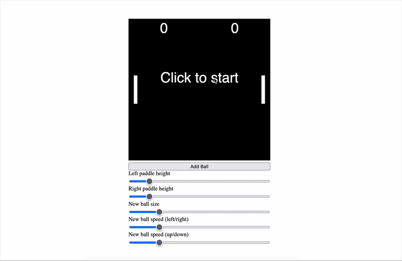

# Week 9

## Process
<!-- What did the team focus on this week? What was your individual contribution, and why? -->

Ok this week's update is not a Figma update but rather a coding update. From our previous meeting with Pippin, it was made clear that we needed to dive deep into the coding aspect of this. Although the figma prototype serves its purpose, we needed to actually build out a technical prototype. Pippin made clear that this was not meant to be a working feature of a product - the code did not need to be implemented in our current visual prototype. We discussed different affordances of game engines like Phaser but settled p5. 

We worked off of a draft he showed us on call. Here are the changes so far:

- The button is now an HTML button outside the canvas.
- The sliders have names.
- Click to start adds the first ball and starts the game.
- Each ball has its own speed, so the earlier bug where every ball changed direction when one hit a paddle is fixed.
- The scoreboard updates with the score.
- Balls reverse when they hit the top or bottom edge.
- A new ball spawns when a point is scored.

[Watch the full screen recording](./images/pong-prototype.mov)

## Reflection
<!-- What did you learn? Which findings carry into the interface? Open questions, references. -->
After our midterm presentations, the team and I discussed how our client, compared to other professors, was less in a rush to get to a working deliverable. Other profs are asking for working prototypes by midterm and are actively user testing in their classes to have it be used by students by finals. It doesn't seem like our client has the same urgency to ship this as a working product. I think the value in the work we do here is going to be working on the coding prototype and actively getting feedback from Pippin - likely poking him on Discord more than once a week. Styling should be a last-to-do, and working on the content of the game education software will push us further. 

## Next Step
<!-- What you plan to do next week. -->
Get feedback from Pippin, and actively work on the code. 

[← Back to journal index](https://github.com/haniflearnscoding/CART470_ProcessJournal/blob/main/README.md)
